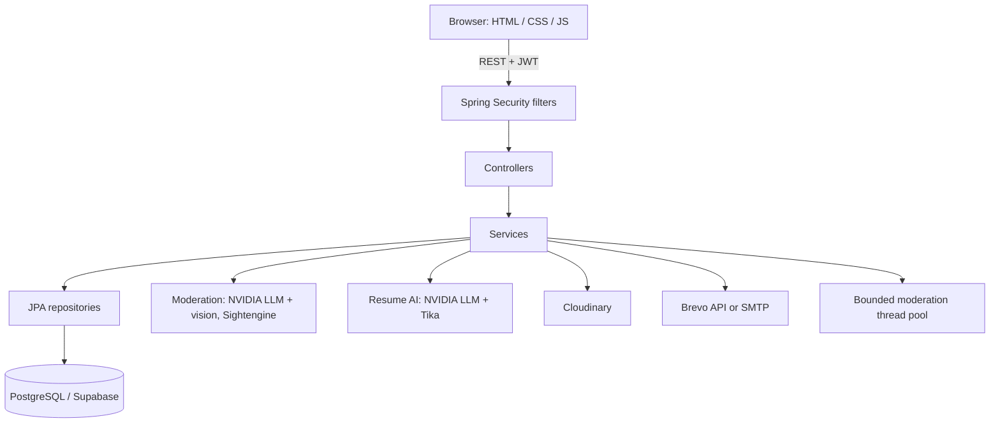

# IETScroll

**A student community platform for the Institute of Engineering and Technology, DAVV (IET DAVV), Indore.**

IETScroll brings three student workflows into one web app: campus **lost and found**, **team formation** for projects and hackathons, and **AI resume feedback**. It also ships with an admin console, a layered content-moderation pipeline, and a campus anti-ragging policy page. The backend is Spring Boot; the frontend is plain HTML/CSS/JavaScript served by the same application.

> This is a student project and is not officially affiliated with IET DAVV.
> This README describes what the source code does today. Planned work is not presented as finished, and known gaps are listed in [Known issues](#known-issues).

## Deployments

The code references two Render deployments:

- https://iet-scroll.onrender.com/ (Swagger server entry)
- https://student-community-platform-ietscroll.onrender.com/ (frontend API base and `app.self-url`)

Local development serves everything on `http://localhost:4040`. The frontend picks its API base automatically: same origin when the port is `4040`, the Render URL otherwise.

## Features

### Accounts and roles
- Register with username, full name, email, course, branch, and passout year. Passwords are hashed with BCrypt. The register form requires 8+ characters; the API itself sets no password rule.
- Email OTP verification before first login: 6 digits, generated with `SecureRandom`, valid 10 minutes, one-time use, 60-second cooldown between requests, locked out after 5 wrong attempts.
- Login (`POST /login`) returns a 24-hour JWT in the `Authorization` response header.
- Roles: `STUDENT`, `ADMIN`, `SENIOR_ADMIN`. The account matching the `ADMIN_EMAIL` setting is promoted to `SENIOR_ADMIN` on login.
- Privilege tiers: `NEW` (default at registration), `NORMAL`, `TRUSTED`, `MAY_BE_SPAM`. Tiers decide how much moderation a user's posts go through (see below).
- Blocked accounts cannot log in (HTTP 403 with a suspension message).
- Profile page, username and full-name updates, logout timestamp tracking.

### Lost and found
- Report lost items (optional reward) or found items, each with name, description, campus location, and an optional photo.
- Rules enforced by the service: location is required, name at least 3 characters, description at least 20 characters, image types `jpeg/png/webp/gif`.
- Limits per user: **2 open lost reports**, **3 pending found reports**.
- A submission with no location is rejected and the student is automatically moved to `MAY_BE_SPAM`.
- Browse open reports (paginated, newest first), view your own, close your own. Each card shows the poster's privilege badge.
- **Views audit:** when a student opens someone else's report, the view is recorded once per viewer; the list of viewers (name and email) can be fetched per report.
- Photos are uploaded to Cloudinary (`IETSCROLL_Lost_Items` folder); PostgreSQL stores the URL and metadata.

### Team Finder
- One open team per owner. A team has a purpose, privacy (`PUBLIC` or `PRIVATE`), maximum size (up to 20), and optional needed skills.
- Public open teams are listed; private teams are not listed but can still be applied to by team ID.
- Students apply with a message. Owners see pending applications and members, then accept, reject, or remove, change the team size, or close the team.
- The team purpose is moderated before saving (emoji ban, anti-ragging check, content-safety check) for every user, regardless of tier.
- Skills are stored against teams, but there is no skill-matching or ranking logic.

### AI resume checker
- Upload a PDF, DOC, or DOCX (max 5 MB), plus target role and years of experience.
- File type is detected from content with Apache Tika, text is extracted, and the model scores it against a rubric in `prompts/ResumeDefaultSystemPrompt.st` (contact, summary, experience, skills, education, formatting, keywords and projects).
- The resume text is wrapped in markers and the prompt tells the model to treat it as data, to reduce prompt injection.
- Structured result: overall rating, content and project ratings, top 5 matched skills, top 10 missing keywords, improvement advice, and one suggested project.
- Limit: **3 analyses per user per calendar month**, tracked in `resume_usage_audit`.
- Feedback is advisory only.

### Moderation pipeline

| Check | Applies to | Behavior |
|---|---|---|
| Emoji ban | All item text; team purpose | Hard reject, all tiers including `TRUSTED` |
| Anti-ragging LLM (senior-junior dynamics, branch superiority, batch hierarchy, harassment) | Item text for `NEW`, `NORMAL`, `MAY_BE_SPAM`; team purpose for everyone | Reject on `VIOLATION`; **allows the post if the model call errors** |
| Content-safety LLM | Item text for `MAY_BE_SPAM`; team purpose for everyone | Reject unless response says safe; **allows the post if the model call errors** |
| Vision relevance (does the photo match the claim, no faces, no memes) | Item photos, non-`TRUSTED` | Runs in parallel with the text checks; **fails closed** on error or empty answer |
| Sightengine (nudity, weapons, gore, violence, self-harm, alcohol, drugs, offensive symbols) | Item photos, non-`TRUSTED` | Rejects above set thresholds; **skipped if Sightengine errors or quota runs out** |

`TRUSTED` users skip all AI checks and only face the emoji rule. Every accepted or rejected submission is written to the user's activity log.

### Admin console
Visible to `ADMIN` and `SENIOR_ADMIN` (all `/api/v1/admin/**` routes):
- Search and filter users (text, privilege tier, blocked state), with their post counts.
- Block or unblock a user. Blocking suspends that user's open lost items, found items, and teams; unblocking restores them.
- Change a user's privilege tier.
- Change a user's role. Only `SENIOR_ADMIN` may do this.
- Close any lost item, found item, or team.
- Analytics: totals for users, blocked users, lost reports, found reports, teams, plus 30-day daily growth series (charted with Chart.js).

### Activity log and safety page
- Each student has a server-side activity history (latest 50 events: uploads, moderation rejections, team requests, resume reviews) that they can clear. A notification list is also kept in browser `localStorage`.
- `safety.html` is a static page covering the anti-ragging policy, privacy guidance, and the platform's disclaimer.

## Tech stack

| Area | Technology |
|---|---|
| Language / runtime | Java 17 |
| Backend | Spring Boot 3.3.2 (Web MVC, Data JPA, Security, Actuator, Validation, Mail) |
| Database | PostgreSQL (configured for Supabase), HikariCP tuned for a cloud pooler |
| Auth | Spring Security, JJWT 0.13.0, BCrypt |
| AI | Spring AI 1.0.0 (OpenAI-compatible client pointed at NVIDIA's API) |
| Models (from `application.properties` and `AIConfiguration`) | `nvidia/nemotron-3.5-bolt-e4b` (anti-ragging and resume), `nvidia/nemotron-3.5-content-safety` (safety), `meta/llama-3.2-11b-vision-instruct` (vision) |
| Document parsing | Apache Tika via `spring-ai-tika-document-reader` |
| Image hosting / moderation | Cloudinary 1.38.0, Sightengine |
| Email | Brevo REST API if `BREVO_API_KEY` is set, otherwise SMTP |
| API docs | springdoc-openapi 2.5.0 (Swagger UI) |
| Frontend | HTML, CSS, vanilla JS, Bootstrap 5.3, Bootstrap Icons, Chart.js |
| Packaging | Maven Wrapper, multi-stage Dockerfile |

## Architecture



It is a modular monolith. Static files live in `src/main/resources/static` and are served by Spring Boot. Item submissions run the text and vision checks in parallel on a dedicated pool (4 core, 12 max threads, queue of 50, caller-runs when saturated).

**Request flow for a lost/found post:** validate input and limits, then run text and vision moderation in parallel (depth depends on the user's privilege tier), then Sightengine, then Cloudinary upload, then save and log.

## Repository structure

```text
src/main/java/com/ietscroll/
├── configuration/   # AI clients, Cloudinary, moderation thread pool, Swagger
├── controller/      # REST controllers (admin, items, team, OTP, resume, activity, views, user)
├── dto/  request/  response/
├── entity/          # JPA entities (users, items, teams, OTP, audit and log tables)
├── exception/       # API exceptions + GlobalExceptionHandler
├── general/enums/   # Branch, Course, statuses, Privacy, PrivilegeClass
├── repository/      # Spring Data repositories and custom queries
├── security/        # JWT util, auth/authorization filters, WebSecurity, Role
├── service/ + impl/ # Business logic and integrations
└── util/            # Sightengine threshold evaluator, multipart helper

src/main/resources/
├── application.properties
├── prompts/         # System prompts (content check, resume rubric)
└── static/          # index, login, register, dashboard, safety pages; js/ and css/
```

## Getting started

### Prerequisites
JDK 17, a PostgreSQL database (Supabase works), and credentials for the external services you want to use. Maven is bundled via `mvnw`.

### 1. Clone
```bash
git clone https://github.com/JustTheGreenPanther28/IETScroll.git
cd IETScroll
```

### 2. Configure
Set environment variables, or put them in `src/main/resources/application-local.properties` (imported automatically if present and gitignored). **Never commit secrets.**

| Variable | Purpose |
|---|---|
| `SUPABASE_DB_URL` | JDBC URL for PostgreSQL |
| `SUPABASE_DB_PASSWORD` | Database password |
| `JWT_SECRET` | HMAC signing secret, 32+ random bytes |
| `NVIDIA_API_KEY` (or `NVIDIA_MISTRAL_KEY` / `NVIDIA_LLAMA_KEY`) | NVIDIA API access; one is enough |
| `CLOUDINARY_CLOUD_NAME`, `CLOUDINARY_API_KEY`, `CLOUDINARY_API_SECRET` | Image hosting |
| `SIGHTENGINE_API_USER`, `SIGHTENGINE_API_SECRET` | Image moderation |
| `BREVO_API_KEY` | OTP email via Brevo REST (preferred on hosts that block SMTP) |
| `BREVO_USERNAME`, `BREVO_PASSWORD` | SMTP fallback when no API key is set |
| `ADMIN_EMAIL` | Account promoted to `SENIOR_ADMIN` on login |

The database username in `application.properties` is hard-coded to a specific Supabase project; change it for your own database. `ADMIN_EMAIL` has a hard-coded fallback in the code, so always set it explicitly in your own deployment.

### 3. Run
```bash
./mvnw clean package -DskipTests
java -jar target/IETScroll-0.0.1-SNAPSHOT.jar
```
Windows: `mvnw.cmd` and `target\IETScroll-0.0.1-SNAPSHOT.jar`. Then open http://localhost:4040/.

First start creates tables through Hibernate (`ddl-auto=update`) and runs a small startup script that resets role and privilege constraints and makes image columns nullable.

### 4. Docker
```bash
docker build -t ietscroll .
docker run -p 4040:4040 --env-file .env ietscroll
```
The app listens on `4040`; the Dockerfile's `EXPOSE 8080` is informational only, so map the right port. The JVM is capped with `-Xmx400m`.

### 5. Docs and health
- Swagger UI: `/swagger-ui/index.html`, OpenAPI JSON: `/v3/api-docs`
- Health: `/actuator/health` (only exposed endpoint)

## API reference

All endpoints need `Authorization: Bearer <token>` except: `POST /login`, `POST /api/v1/user/register`, `POST /api/v1/otp/verify`, Swagger, `/actuator/health`, and the static pages.

**Auth and users**

| Method | Endpoint | Description |
|---|---|---|
| POST | `/api/v1/user/register` | Register and send OTP |
| POST | `/api/v1/otp/verify` | Verify OTP, activate account |
| POST | `/login` | JSON `{email, password}`; token in `Authorization` response header |
| GET | `/api/v1/user` | Current profile |
| POST | `/api/v1/user/logout` | Record logout time |
| PATCH | `/api/v1/user/username/{newUsername}` | Change username |
| PATCH | `/api/v1/user/fullname/{fullname}` | Change full name |

**Lost items** (`/api/v1/lost-item`) and **found items** (`/api/v1/found-item`)

| Method | Endpoint | Description |
|---|---|---|
| POST | `/` | Create; multipart parts `data` (JSON) and optional `image` |
| GET | `/?page=0&size=10` | Browse open (lost) / pending (found) reports |
| GET | `/me` | Your active reports |
| PATCH | `/close?lostItemId=` / `?foundItemId=` | Close your report |

**Teams** (`/api/v1/team`) and **join requests** (`/api/v1/request-team`)

| Method | Endpoint | Description |
|---|---|---|
| POST | `/api/v1/team` | Create team (`purpose`, `teamSize`, `privacy`, `skillIds`) |
| GET | `/api/v1/team?page=&size=` | Public open teams |
| GET | `/api/v1/team/me` | Your open team |
| PATCH | `/api/v1/team/close` | Close your team |
| PATCH | `/api/v1/team/team-size?teamSize=` | Change max size |
| POST | `/api/v1/request-team` | Apply (`teamId`, `message`) |
| GET | `/api/v1/request-team/requests` | Pending applications to your team |
| GET | `/api/v1/request-team/team-members` | Accepted members |
| PATCH | `/api/v1/request-team/accept/{email}`, `/reject/{email}`, `/remove/{email}` | Manage applicants and members |
| GET | `/api/v1/request-team/my-application` | Applications you submitted |

**Other**

| Method | Endpoint | Description |
|---|---|---|
| POST | `/api/v1/ietscroll/resume/quality` | Multipart `file`, `exp`, `role` |
| GET / DELETE | `/api/v1/user/activities` | Read or clear your activity log |
| POST / GET | `/api/v1/report-views/{reportId}` | Record a view (`?type=LOST\|FOUND`) / list viewers |

**Admin** (`/api/v1/admin`, `ADMIN` or `SENIOR_ADMIN`)

| Method | Endpoint | Description |
|---|---|---|
| GET | `/users?query=&privilege=&isBlocked=&page=&size=` | Search users |
| POST | `/users/{email}/block`, `/users/{email}/unblock` | Block or unblock |
| PATCH | `/users/{email}/role?role=` | Change role (`SENIOR_ADMIN` only) |
| PATCH | `/users/{email}/privilege?privilege=` | Change privilege tier |
| PATCH | `/lost-item/{id}/close`, `/found-item/{id}/close`, `/team/{id}/close` | Close any item or team |
| GET | `/analytics` | Totals and 30-day growth series |

Errors return `{ timestamp, message }`; database and unexpected exceptions are sanitised so SQL or stack details do not reach the client.

## Known issues

These come from reading the source at the time of writing; none were reproduced by running the app. They are ordered by how likely a user is to hit them.

**Frontend and backend disagree**
- **Team size is sent under the wrong name.** The UI posts `maxMember`; the API reads `teamSize`. The controller does not use `@Valid`, so the value falls back to `0`, and accepting an applicant then fails with a "maximum team size" error until the owner calls the team-size endpoint.
- **Endpoints the UI calls that do not exist:** `GET /api/v1/skill` (the skills dropdown stays empty; there is no skills controller or seed data), `PATCH /api/v1/request-team/kick/{email}` (the API route is `/remove/`), `PATCH /api/v1/request-team/leave/{teamId}` (the service method exists, no route), and `GET /api/v1/request-team/my-applications` (the API route is `/my-application`).
- **The resume result panel reads fields the API does not return.** The UI expects `score`, `overallQuality`, `strongPoints`, `missingKeywords`, `suggestions`; the API returns `overAllRating`, `rateContentQuality`, `rateProjects`, `topFiveSkillsMatched`, `topTenKeywordsMissed`, `improvement`, `suggestedUnqiueProject`. The prompt also caps the rating at 10 while the UI shows `/100`.
- **Upload size.** No `spring.servlet.multipart.*` limits are configured, so Spring Boot's default of 1 MB per file applies, below the 5 MB resume limit in the service and larger than most phone photos.
- **No OTP resend.** The path is whitelisted in security config but no controller exists. Registering again with the same email returns a duplicate error, so an unverified account whose OTP expired has no recovery path.
- **The college email domain is not enforced.** `CollegeDefaults` holds `@ietdavv.edu.in` but nothing uses it; any valid email can register.

**Security and hardening**
- Blocking, role changes, and demotions do not affect tokens already issued; the filter trusts the JWT for up to 24 hours without a database check.
- Any `ADMIN` can block any user, including a `SENIOR_ADMIN`. Only role changes check for `SENIOR_ADMIN`.
- Any logged-in student can list the names and emails of everyone who viewed any report (`requesterEmail` is accepted but not used). Confirm this is intended.
- CORS allows every origin with credentials enabled. The JWT lives in `localStorage`.
- Moderation fails open for the text LLM checks and Sightengine (see the table above). The longer image-safety prompt in `NvidiaVisionServiceImpl.checkImage` is never called.
- Item images are validated by the client-supplied content type only.
- Resume `role` is inserted into the system prompt, and a non-numeric `exp` causes a server error.
- Rate limiting: Bucket4j is a dependency but unused. There is no throttling on `/login`.

**Maintenance**
- `recordView` loads every lost or found item with `findAll()` and filters in memory; list endpoints also look up the poster once per row.
- `acceptMember` checks capacity and then increments without locking, so concurrent accepts can overshoot. `TeamStatus.FULL` is never set.
- Schema management relies on `ddl-auto=update` plus DDL run at every startup; consider migrations (Flyway or Liquibase).
- No tests exist (`src/test` is absent and the test starter is not a dependency).
- `@EnableScheduling` has nothing scheduled, and `spring-boot-starter-websocket` sits in `dependencyManagement` without being a dependency.

## Contributing
1. Branch from `main` with a focused change.
2. Keep secrets out of commits.
3. Add tests for behavior changes, and update this README when endpoints or limits change.

## License
No license file is present. Add one before inviting reuse.
